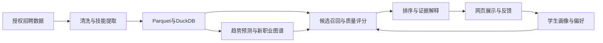

# P19｜SmartCareer 个性化就业推荐系统后续规划

> 中文内部实施规划，编写日期：2026 年 10 月 14 日；阶段计划更新：2026 年 10 月 15 日。依据项目目录第 64–66 页及现有竞标初稿。本文以获得 P19 后由完整七人团队在 2026 年 10 月 21 日至 2027 年 4 月 1 日期间实施为前提，与 P21、P30 互为备选，不代表志愿排名。技术、数量和时间安排均为建议，数据访问、资源和验收口径需在启动时确认。

## 1. 项目目标与最终使用场景

SmartCareer 面向大学生，帮助用户理解“哪些岗位适合我、为什么适合、还缺什么技能”。用户录入专业、技能、资格、地区和职业偏好，调整薪资、成长、稳定性、技能匹配的重要程度，获得带四维评分和解释的岗位列表；查看技能差距与相近职业，再通过收藏和相关性反馈改进推荐。

项目亮点应落在真实数据、透明评价和可验证的排序效果。历史招聘数据用于需求分析与回测，页面必须展示数据时效，不能把历史记录作为当前仍可申请的岗位。目录数据截至 2025 年 6 月，是否补充现行岗位信息另行确认。

## 2. 正式要求与交付范围

| 范围 | 内容与完成安排 |
| --- | --- |
| 目录要求 | 清洗已有招聘数据；技能提取与时间序列预测；新职业识别及图谱；四维可调评分；学生画像、混合排序、解释与反馈；HR@k、NDCG、MRR 和用户试用；报告、代码与演示。 |
| 建议首版 | 12 月 15 日前在浙江代表性子集上实现清洗、技能词典、四维评分和关键词排序，提供命令行或简单页面验证。 |
| 完整目标 | 12 月 15 日前形成趋势预测、职业图谱和语义匹配先导结果及界面骨架；3 月 1–9 日完成画像、图谱展示与反馈集成，3 月 10–16 日完成正式对照、获准试用及必要修复。 |
| 可选扩展 | 数据和时间允许时增加学习排序、图谱辅助召回及更大地域覆盖；独立图数据库不是首版依赖。 |

目录称研究组已有 9,652,000 条记录，含浙江毕业生及上市公司子集；实际授权范围、字段、重叠关系和可交付形式需核对。先取得样例和数据字典，再确定子集规模与扩容目标。未取得真实数据时，合成样例仅验证接口。

## 3. 推荐技术路线与系统架构

建议采用 Python、pandas 分批清洗，Parquet 保存离线结果，DuckDB 查询大规模岗位特征；SQLite 存放用户、偏好和反馈。算法使用 scikit-learn，图谱使用 NetworkX，后端 FastAPI，前端 React。这样能让数据、算法和页面独立推进，避免将千万级处理塞入在线请求。

离线服务输出带版本的岗位特征、趋势和图谱；在线 API 接收画像和权重，返回岗位、分数、技能差距、解释及数据时间。清洗规则、词典和评分配置一并版本化，使一次推荐可以复现。

## 4. 关键模块实施思路

**数据工程。** 输入原始记录，统一岗位、公司、行业、地区、学历和经验字段，处理缺失、跨平台重复与异常工资。保留原值、来源和转换规则，工资转换为可比较月薪区间；面议、多薪和无法判断周期的记录单独标识，不直接填零。输出可查询数据、质量统计及数据字典。

**技能与趋势。** 先以技能词典、同义词和规则提取为基线，再比较语义方法对简称与上下文的改善。按月或季度统计职业内技能占比，减轻平台覆盖变化造成的数量偏差；用季节性朴素预测对照滞后特征回归模型。职业样本不足时不给强预测，报告覆盖量与误差。

**新职业图谱。** 将持续出现的新名称、技能组合变化和需求增长作为候选信号，人工核查改名与平台迁移等情况。构建职业、技能节点及“需要技能”“职业相似”边，边带频次和时间依据，展示毕业生可进入的相邻职业与差距。数据中出现较晚不等于社会中新诞生，输出称为“候选新兴职业”。

**四维评价。** 薪资按同期、同地区及同类岗位分位数评价；成长参考职业需求和技能趋势；稳定性参考历史需求波动与持续性；技能匹配由用户与岗位技能重合及语义相似度计算。成长、稳定是代理指标，不能直接证明晋升或岗位安全。四维归一化后加权，权重非负且总和为一；缺失维度展示覆盖情况，并按有效维度重新归一化，避免未知岗位获得虚假优势。

**画像与推荐。** 画像包含专业、技能、资格、地区、薪资期望及职业优先项。先按地区和岗位资格召回，处理限制过严导致无结果的情况；再将技能匹配和四维质量融合排序，明确公式，避免技能项重复加权。对照关键词、纯技能及融合方案，只有验证改善后再增加嵌入匹配。

**解释与反馈。** 从实际计算结果生成“匹配哪些技能、哪里有差距、哪个维度拉高分数”等说明，并展示图谱依据。收藏不直接等于相关性标签；显式反馈产生权重调整建议，由用户接受后生效。允许恢复默认偏好，保留调整记录。

## 5. 2026 年 10 月 21 日至 2027 年 4 月 1 日的开发计划

| 日期区间 | 重点工作 | 交付物 | 阶段验收条件 |
| --- | --- | --- | --- |
| 2026-10-21 至 2026-11-03 | 核对数据与需求，试读样例，确定标签方案和设备预算 | 需求表、数据字典初版、资源记录 | 样例可读；明确数据时效、七人安排和最终覆盖范围。 |
| 2026-11-04 至 2026-11-24 | 分批清洗、工资归一化、技能词典与关键词基线 | 清洗流水线、质量统计、基线结果 | 同一输入可重复处理；重复、缺失和异常样例有处理记录。 |
| 2026-11-25 至 2026-12-15 | 四维评分、趋势／图谱、首版推荐与先导对照 | 核心流程、接口骨架、对照脚本 | 授权子集可从画像到推荐；可调权重、技能差距和图谱可演示。 |
| 2027-01-06 至 2027-02-28 | 词典／评分复核、已有结果整理、文档草稿 | 维护记录、三月清单 | 每人每周至多一项异步小任务；无关键集成或试用依赖。 |
| 2027-03-01 至 2027-03-09 | 完善网页、反馈与版本接口 | 完整流程、API 文档 | 可完成录入、推荐、解释、反馈及再次推荐；保留可运行基线。 |
| 2027-03-10 至 2027-03-16 | 固定配置对照、获准试用、性能与必要修复 | 评估报告、修复清单 | 三种排序对照可复现；关键问题已修复或说明。 |
| 2027-03-17 至 2027-03-30 | 冻结、回归、部署、报告与演示 | 发布版本、报告、使用文档 | 新环境可启动；核心场景通过；材料一致。 |

每阶段结束与导师核对下一阶段范围。3 月 1–9 日完成集成后优先评估、修复和交付，不再新增复杂推荐模型。

以下按表中的七个日期阶段展开，不设固定开发周数；任务量按阶段目标和成员可用时间安排。2026-12-16 至 2027-01-05 用于进度调整与资料整理；2027-01-06 至 2027-02-28 为低负荷阶段，一月至二月的学校假期日期仍以正式通知为准；2027-03-31 至 2027-04-01 用于提交检查。首版流程、接口骨架与先导实验前移至十二月，三月在已有成果上集中集成与评估。

### 课程节点与阶段衔接

以下节点依据用户提供的 **暂定关键日期表** 制定，正式通知变化时同步修订三份方案及六份竞标书。

- **2026-10-21：** 开始设备／资源申请；结合本项目的数据、模型与部署需求记录预算和可用条件。
- **2026-10-28：** 伦理表提交；覆盖本项目的数据使用、知情同意及拟议用户／领域评估，参与者相关工作在取得所需批准后进行。
- **2026-11-05：** 团队项目网站上线，仅展示可公开的项目介绍、职责、进度及示例。
- **2026-12-10：** 中期报告提交；报告截至 12 月 10 日已取得的需求、架构、基线和初步核心模块证据，以及风险与后续安排。12 月 15 日前完成首版可演示流程与先导实验；1 月 6 日开始低负荷阶段。
- **2026-12-16 至 2027-01-05：** 整理资料、收集反馈，并按需要完成前面尚未完成的任务；不安排关键集成、参与者试用或必须完成的训练。
- **2027-01-06 至 2027-02-28：** 按低负荷推进，仅做小型异步维护、已有结果复核和文档；不安排关键交付、必须训练或参与者试用。
- **2027-03-01 至 2027-03-09：** 完成已有模块的集中集成。
- **2027-03-10 至 2027-03-16：** 并行完成正式评估、获准试用及必要修复。
- **2027-03-17：** 冻结功能、模型与规则，进入回归、部署和交付。
- **2027-03-30：** 完成发布版本、最终报告、文档与演示材料。
- **2027-03-31 至 2027-04-01：** 提交检查；于 **4 月 1 日前**提交团队最终报告及软件，核对文件、权限与回执。后续软件演示、团队展示及宣传材料所需素材在本阶段准备，其课程提交节点在本开发计划之外。

### 5.1 需求确认与数据摸底（2026-10-21 至 2026-11-03）

- **确认使用流程。** 与导师讨论学生录入哪些信息、推荐结果展示哪些内容、反馈如何影响权重；把需求分为必须完成、建议完成和可选扩展，形成可演示的核心场景。
- **取得并检查数据样例。** 核对访问方式、字段、时间跨度、各平台覆盖及浙江子集关系；抽查工资、岗位名称和技能描述，统计缺失与重复情况，记录数据不可直接使用的原因。
- **确定处理范围与接口。** 以样例测量读取速度和内存占用，选择首版数据子集；约定数据表、用户画像及推荐返回字段，提供样例输入输出供数据、算法和页面人员共同使用。
- **提前设计评估。** 确定时间划分、技能核查样本和画像标注方法，准备相关性判断说明；同时安排模块负责人、集中开发阶段的每周集成时间（低负荷期改用异步简报）及数据缺口处理方式。

**阶段成果：** 需求与范围清单、数据字典初版、数据质量摸底记录、接口草案和评估方案。进入下一阶段前，应能读取授权样例，并明确首版数据范围；未解决的数据权限或字段问题列入导师确认清单。

### 5.2 数据清洗与基础匹配（2026-11-04 至 2026-11-24）

- **搭建清洗流水线。** 完成分批读取、字段映射、日期与地区统一，处理岗位重复、缺失学历和异常记录；保留原始值及清洗原因，避免后续无法追溯。
- **统一工资与技能。** 处理月薪、年薪、多薪和面议，生成标准工资字段及可用状态；整理技能词典、简称和同义词，建立规则提取基线，并人工检查典型错误。
- **建立查询与关键词基线。** 将清洗结果写入 Parquet／DuckDB，支持地区、学历、职业和技能筛选；用关键词匹配返回岗位列表，作为后续融合排序的比较对象。
- **检查质量与运行成本。** 固定一批样例重复运行，检查清洗一致性、技能提取效果和查询性能；根据实测决定是否扩展数据规模，整理下阶段可直接读取的特征表。

**阶段成果：** 可查询数据子集、清洗脚本、工资转换规则、技能词典初版和关键词推荐基线。交接时同时提供字段说明、数据版本与质量统计，确保评分模块不再自行重复清洗。

**并行准备：** 本阶段同步搭建基础页面／接口骨架及可复用评估样例，供十二月的首版流程使用。

### 5.3 评价模型与首版推荐（2026-11-25 至 2026-12-15）

- **实现四维评分。** 分别计算薪资、成长、稳定性和技能匹配，明确归一化与缺失处理；用同一画像调整权重，检查排名变化是否与公式及解释一致。
- **同步建立趋势与图谱初版。** 汇总按时间变化的职业和技能需求，比较朴素预测与回归基线；构建职业—技能关系和职业相似关系，人工核查候选新兴职业的依据。
- **连接画像与混合排序。** 实现画像保存、资格与地区筛选、候选召回及评分融合；处理候选不足，返回匹配技能、技能差距和各维度分数，避免技能匹配重复加权。
- **12 月 15 日前完成首版演示。** 通过命令行或简单页面展示“录入画像—设置权重—获得岗位—查看解释”；用小规模已标注样例检查排序，并记录缺失数据、无候选和异常权重等问题。

**阶段成果：** 四维评分模块及说明、趋势预测对照、新职业图谱初版和首版推荐流程。首版应能使用真实授权子集运行，趋势回测只使用预测时点之前的数据。

**并行前移任务：** 并行准备 React/TypeScript 与 FastAPI 接口骨架、最小显式反馈样例，以及关键词、纯技能和语义匹配先导对照及可复用评估脚本；于 12 月 10 日前依据届时已有证据提交中期报告，12 月 15 日前归档代码／数据版本及集成问题。各模块按七人分工并行推进，先采用已约定的受控样例，不同时扩大数据、企业或影片规模。

### 5.4 低负荷维护与异步准备（2027-01-06 至 2027-02-28）

- **按可用时间安排小任务。** 考虑一月至二月可能涉及寒假，每人每周至多一项小型异步任务；建议控制在约 1–2 小时，可按实际可用时间下调，不设必须全员同步的开发会议。
- **复核已有材料。** 以独立小任务复核已有技能词典、数据质量记录、评分解释及已保存的先导结果，起草 API 与用户文档；这些任务不作为三月流程推进的阻塞依赖。
- **整理文档和三月清单。** 通过异步简报维护问题清单，基于已有资料整理测试标签、试用说明及三月优先事项；一月至二月不设完整应用交付承诺，3 月 1 日恢复集中集成。
- **不建立关键依赖。** 不安排核心模块交付、跨模块集中联调、必须完成的训练或参与者试用；未完成的小任务可移到三月，不影响首版运行。3 月 1 日恢复集中集成。

**阶段成果：** 已有版本的维护记录、文档草稿及三月优先任务清单；不以新功能数量作为阶段验收指标。

### 5.5 网页集成与反馈流程（2027-03-01 至 2027-03-09）

本阶段仅完善已准备的模块与接口，按七人分工并行联调；保留首版基线，暂缓非核心扩展，避免三月从零开发。

- **本阶段完成后端接口。** 提供画像、偏好、推荐、收藏和显式反馈接口；关联数据与评分版本，统一错误返回，保证每次推荐能够追溯使用的输入和配置。
- **完成主要页面。** 建设画像录入、权重调节、推荐列表和岗位详情，展示技能差距、四维分数、数据时间及职业关系；对无结果和数据不足给出可理解的提示。
- **接入已有语义匹配对照。** 在固定候选集上比较关键词与嵌入匹配的质量、耗时和资源占用；验证有效后再接入主流程，图谱展示与基础推荐同步联调。
- **本阶段打通反馈与集成。** 将反馈转为可接受或撤回的权重调整建议，支持恢复默认偏好；检查录入、推荐、解释、反馈和再次推荐的数据传递，修复前后端字段不一致的问题。

**阶段成果：** 可操作网页、完整 API 文档、语义匹配比较记录和反馈流程。阶段结束时，用户应能独立完成一次推荐及偏好调整，并看懂排序变化的主要原因。

### 5.6 效果评估与体验改进（2027-03-10 至 2027-03-16）

使用十二月准备的脚本、开发样例及低负荷期整理的现有材料；正式测试划分在评估开始前锁定。算法／抽取对照、获准用户或业务复核、性能检查分组并行，优先必要修复，不追加新模型。

- **本阶段锁定正式评估配置。** 固定时间划分、画像、候选集合、标签和模型版本，复核重复岗位是否跨集合；区分开发样例与最终测试样例，避免调参使用测试信息。
- **本阶段完成对照实验。** 比较关键词、纯技能和融合排序，报告 HR@k、NDCG、MRR 及召回覆盖；核查技能提取与趋势误差，分析四维评分和语义匹配分别带来的作用。
- **本阶段组织用户试用。** 按第 7 节建议规模邀请学生完成录入、调权重和查看技能差距等任务；记录操作困难、解释误解、满意度及建议，区分排序效果与界面体验问题。
- **本阶段集中修复与优化。** 根据问题优先级改进提示、解释和异常处理，测量在线响应与批处理资源占用；必要时增加索引、预计算或缓存，再对修复涉及的场景做回归检查。

**阶段成果：** 可复现评估报告、用户试用记录、性能结果和已处理问题清单。没有改善的模型方案也应保留实验结论，最终选择兼顾效果与运行成本的版本。

### 5.7 发布准备与最终交付（2027-03-17 至 2027-03-30）

- **3 月 17 日冻结功能并完成回归。** 固定代码、词典、评分及模型版本，检查核心流程和边界场景；核对页面解释、数据时效与实验结论是否一致，处理影响演示的缺陷。
- **3 月 17–23 日验证安装与复现。** 在新环境按文档安装依赖、准备授权数据并启动服务；复跑代表性评估，补齐数据获取条件、部署步骤、配置说明和用户指南。
- **整理最终材料。** 汇总需求、架构、清洗与算法说明、评估和试用结果；区分可交付数据与仅能说明获取方式的资料，检查代码及文档中的路径和版本。
- **3 月 24–30 日排练演示与移交。** 用同一画像展示权重变化、技能差距和职业关系，准备异常场景的说明；交付发布版本、报告和演示材料，列出已知限制及后续改进建议。

**阶段成果：** 可部署完整系统、源代码与配置、最终报告、使用文档及演示。最终检查以新环境启动成功、核心流程通过和评估能够复现为准。

## 6. 七人分工与协作方式

我们根据已有经历和兴趣安排以下分工，遇到不熟悉的方法时共同学习，并通过进度讨论和导师反馈调整任务。以下为获得该项目后的实施计划，P19、P21、P30 互为备选。

| 成员 | 主要分工 |
| --- | --- |
| Ziqian XIONG | 协调团队及导师沟通，结合科研和软件项目经历指导系统设计、技能匹配、排序实验与模型集成。 |
| Yun Xin NG | 结合数据工程和机器学习经历，准备与清洗招聘数据、统一薪资字段，并开展技能趋势预测。 |
| Jinyao LU | 整理学生需求、组织试用，检查推荐解释是否易于理解，并准备使用文档和演示。 |
| Oswald Yiwen CHONG | 结合应用开发和 CI/CD 经验，开发后端服务、连接应用模块，并支持 GitHub 协作、自动检查与部署。 |
| Ziqian ZHANG | 结合科研数据准备经历，整理并核对技能和职业样本、维护标注，并记录数据及推荐错误。 |
| Yue WU | 开发技能归一化规则、四维评分和职业关系，比较不同方法，并说明评分依据。 |
| Xinyun HU | 开发学生画像、偏好设置和推荐结果页面，对接后端，并检查筛选、权重调整与反馈交互。 |

Yun Xin NG 与 Ziqian ZHANG 共同核查数据样本，Yue WU 与 Ziqian XIONG 共同讨论评分和排序结果；应用开发与用户试用将连接这些结果和学生使用体验。

集中开发阶段每周讨论进度并检查集成，组长帮助成员拆解任务和协调困难；2027 年 1 月 6 日至 2 月 28 日每人每周至多一项小型异步任务，按可用时间调整，不安排关键集成、必须完成的训练或参与者试用。

数据、算法和应用工作通过共享样例连接。项目目录建议 3–5 人，本方案按七人安排，启动时与导师核对团队规模适配。

## 7. 测试、评估与验收

- **功能正确性**：覆盖面议工资、同义技能、缺失画像、零权重、无候选及重复岗位；解释与分数一致，反馈调整可撤回。
- **模型效果**：建议人工双人核查约 200 条技能样本及至少 30 份测试画像，按相关性等级评价候选岗位；这是评估目标，数量随数据调整。报告技能 Precision、Recall、F1，趋势 MAE，以及 HR@5/10、NDCG@5/10、MRR。只有相关性标注后才计算推荐指标，说明标注范围和偏差。
- **实验有效性**：按时间训练、验证、测试，词典及参数不使用测试期信息；重复招聘记录不跨集合。固定候选集和标签比较排序，另报召回覆盖；无法获得行为数据时明确评价来自人工判断。
- **性能与体验**：记录机器、数据规模、处理时间、内存及在线响应 p95。建议普通单用户请求 3 秒内返回作为初始目标，实测后确认；建议邀请 8–12 名学生试用，记录任务完成、解释理解和满意度。

验收以核心流程、数据追溯和可复现实验为基础。效果是否优于基线必须由实验说明，不预先承诺固定提升幅度。

## 8. 资源依赖、主要风险与应对

数据权限或到达时间影响真实评估；若 11 月 3 日前仍无法取得样例，应向导师确认交付调整，接口开发可继续，数据效果结论延后。千万级数据超出内存时用分批处理、分区查询和特征预计算，报告实际覆盖规模，不声称已完成全量处理。

平台和年份分布变化会影响趋势，需按来源与时间检查覆盖，并在报告中列出偏差。标签不足时优先保证人工标注质量，收缩评价范围。公开仓库只放允许共享的样例和处理代码；学生画像采用最小字段，并支持删除。GPU 未定时保留 CPU 基线，语义模型作为经资源验证后的改进。

## 9. 最终交付清单与项目亮点

交付需求与架构说明、清洗代码和数据字典、授权范围内的数据结果、技能词典与特征、趋势模型及回测、新职业图谱、四维评分配置、推荐与评估模块、网页应用、部署手册、用户试用报告和现场演示。演示用同一画像调整权重，展示排序变化、技能差距及职业路径，突出系统解释与数据依据。

依据：[项目目录第 64–66 页](../docs/projects/GRP-Project-Catalogue-2627-202610131035%282%29.pdf)、[P19 竞标初稿](bid_P19.tex)。正式要求以目录为准，本文方案用于小组讨论与后续需求确认。
