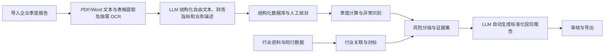

# P21｜私募股权投后季度报告分析系统后续规划

> 中文内部实施规划，编写日期：2026 年 10 月 14 日；阶段计划更新：2026 年 10 月 15 日。依据项目目录第 70–71 页及现有竞标初稿。本文以获得 P21 后由完整七人团队在 2026 年 10 月 21 日至 2027 年 4 月 1 日期间实施为前提，与 P19、P30 互为备选，不代表志愿排名。技术、数量和时间安排均为建议，报告样本、行业资料、资源和验收口径需在启动时确认。

## 1. 项目目标与最终使用场景

系统面向私募股权投后分析人员，以 LLM 为核心，导入被投企业季度报告，提取 PDF/Word 文本与表格，将自由文本、财务指标和业务描述结构化存入数据库，并自动生成标准化投后报告。报告汇总企业与行业季度动态分析、同行对标和分级风险，以及持有／退出／减值提示与价值创造建议。用户可核对提取内容、查看分析依据，并审核和导出生成的报告。

优先解决重复整理、口径不一致和报告复核困难的问题。每个关键数字与风险结论能回到原文，人工修改能够留痕。系统生成持有、退出、减值提示及价值创造建议，由分析人员审核后采用，不直接执行投资决策。

## 2. 正式要求与交付范围

| 范围 | 内容与完成安排 |
| --- | --- |
| 目录要求 | PDF/Word 文本与表格提取；自由文本、财务指标和业务描述结构化入库；企业时间序列和行业季度双动态分析；自动异常归因；同赛道同阶段对标、相对位置及季度排名变动；经营、合规、团队变动、业绩对赌风险分级；LLM 自动生成标准化投后报告，含持有／退出／减值提示及价值创造建议。 |
| 建议首版 | 12 月 15 日前打通一家企业的多季度报告导入、文本与表格提取、LLM 结构化入库、人工核对、财务计算、基础风险与标准化报告自动生成。 |
| 完整目标 | 12 月 15 日前准备行业、同行及四类风险先导样例和界面骨架；3 月 1–9 日完成多企业、行业／同行、风险和审核导出集成，3 月 10–16 日完成来源核查、获准试用及必要修复。 |
| 可选扩展 | 行业估值倍数、动态估值、完整多季度仪表盘与资产池长期监控；首版仍保留必要趋势图。 |

目录明确交付解析与报告生成原型、可适配机构内部流程的标准模板、季度监控指标及风险规则库。先确认机构模板、指标定义和样本授权，再定支持范围；暂以 `.pdf`、`.docx` 为入口，旧 `.doc` 文件的转换需求在启动时核对。

## 3. 推荐技术路线与系统架构

建议采用 React + FastAPI + MySQL：Python 配合 PyMuPDF/pdfplumber 提取 PDF 文本与表格，python-docx 读取 Word 段落与表格；按页优先直接提取，只对扫描页或图片文字使用 PaddleOCR。MySQL 保存企业、季度、结构化自由文本信息、财务指标、业务描述、证据关联、风险规则和核验／审核版本，原始文件及导出报告使用文件系统或对象存储；解析文本和表格结构先用 MySQL JSON 保存，首版暂不引入 MongoDB。表格保留表头、单元格位置、单位和来源，CSV 用于导入导出。金额使用 MySQL DECIMAL 与 Python Decimal，明确舍入规则；pandas 辅助整理分析，python-docx 与 HTML 模板用于报告导出。

LLM 负责将提取的自由文本、财务指标和业务描述组织为预定义数据库模式下的结构化数据，并依据库内数据及支持证据，将企业与行业分析、同行对标、风险和建议自动汇总至标准化投后报告模板；计算、单位转换和风险阈值由程序负责。模型通过适配层调用，先按样例质量、隐私要求和资源选定部署方式。

语义检索作为核心闭环稳定后的增强：先评估 BGE-M3 的中英文检索效果，以 FAISS 保存向量索引，MySQL 管理片段、来源与版本。检索须先限定企业、期间、访问权限和有效版本，再排序候选证据；向量用于寻找原文，不能替代指标抽取和财务计算。索引更新和备份与文档版本保持一致，后续过滤或并发更新需求增加时再考虑 Qdrant。数据库设计和查询使用 JetBrains DataGrip，应用开发使用 PyCharm 或 VS Code，部署考虑 Docker Compose。以上为候选技术路线，须以真实样本和可用资源验证。

内部数据传递保留企业、期间、自由文本信息与业务描述的结构化字段、原始指标名、数值、币种、单位、口径、来源位置和核对状态。API 提供导入、核对、分析、报告生成及导出；导入后返回任务编号，解析完成再展示结果，避免大文件阻塞页面。

## 4. 关键模块实施思路

**解析与抽取。** 导入原报告，区分文本型与扫描型，提取 PDF/Word 文本与表格，保留 PDF 页码、表格位置及 Word 段落或表格标识。LLM 将自由文本、财务指标和业务描述结构化，按固定字段模式入库；模板和规则提取作为对照基线，解析与校验规则辅助检查模型输出。引用片段由解析器定位核验，模型置信度不能替代准确性验证。低质量 OCR、冲突数字和缺失来源进入待核对列表。

**指标标准化。** 建立与业务方核对的指标字典，首版建议覆盖收入、利润、现金、现金流、费用及业务规模。保存原值与标准值，区分万元／亿元、单季／累计、合并／母公司口径。累计值转单季需相邻期间且口径一致；无法换算时禁止混比。人工修正建立新版本，并使受影响分析与报告重新生成。

**企业季度分析。** 同口径计算 QoQ、YoY 和利润率等指标，输出公式、比较期间和缺失说明。建议取得连续至少五个季度以覆盖最新季度同比，这不是目录规定数量。基期为零时不输出增长率；负基数改报绝对变化及说明，不用误导性的正增长表示改善。异常先按规则定位，再结合业务原文提出归因，区分“原文已说明”与“待核查假设”。

**行业与同行。** 导入带来源、发布日期及适用季度的政策、市场和赛道材料，分析企业可能受益或承压的机制。历史回测只使用当时可获得的信息。同行先按赛道、阶段、规模和指标口径筛选，再给分位位置及排名变动；两期使用可比同行集合，样本变化单独说明。同业数据缺失时显示无法对标，不能由模型生成假企业或假排名。

**风险规则库。** 每条规则保存风险类别、触发条件、适用口径、等级、依据和版本。覆盖现金流与收入异常、合规事项、关键人员变动及对赌履约；对赌计算依赖真实协议目标、期限和计量方式。缺少协议时输出无法判断。首次阈值由样例与业务方讨论确定，调参使用验证集，规则触发产生可复核风险项。

**标准化报告自动生成。** LLM 依据库内已核对的自由文本信息、财务指标、业务描述及分析结果，将经营概况、财务变化、行业环境、同行比较、分级风险、持有／退出／减值提示及价值创造建议自动汇总至可适配机构内部流程的标准化投后报告模板。程序检查生成数字与引用是否对应，未通过部分返回核对。原文中的指令仅作材料处理，不控制系统行为。导出保留数据截止时间、版本、审核状态和证据附录，未审核文件标记为草稿。

## 5. 2026 年 10 月 21 日至 2027 年 4 月 1 日的开发计划

| 日期区间 | 重点工作 | 交付物 | 阶段验收条件 |
| --- | --- | --- | --- |
| 2026-10-21 至 2026-11-03 | 访谈、样本授权、模板与指标口径，试解析 | 需求表、样本清单、指标字典初版 | 至少一个报告样例可解析；明确行业、同行和协议资料来源。 |
| 2026-11-04 至 2026-11-24 | PDF/Word/OCR、结构化字段与核对页面 | 解析基线、人工核对集、来源映射 | 样本数字能定位原文；单位、季度和缺失状态保留完整。 |
| 2026-11-25 至 2026-12-15 | 季度计算、首版报告、行业／同行与风险先导 | 单企业闭环、规则样例、对照脚本 | 数字可复算；修正源数字可更新分析与报告。 |
| 2027-01-06 至 2027-02-28 | 指标／来源复核、样例整理、文档草稿 | 维护记录、三月清单 | 每人每周至多一项异步小任务；不新增分析模块。 |
| 2027-03-01 至 2027-03-09 | 行业／同行、四类风险与审核导出集成 | 完整原型、规则库、API | 有数据输出对标与分级，无数据明确提示；报告可审核导出。 |
| 2027-03-10 至 2027-03-16 | 抽取对照、业务复核、可靠性与必要修复 | 评估报告、修复清单 | 关键数字和来源通过核查；误报漏报有分析。 |
| 2027-03-17 至 2027-03-30 | 冻结、部署、报告与演示 | 发布版本、最终报告、使用手册 | 新环境可启动；标准场景贯通；测试可复现。 |

明确资料不足的影响，冻结首版指标口径，3 月 1–9 日完成集成后主要改进可靠性，避免临近交付增加估值功能。

以下按表中的七个日期阶段展开，不设固定开发周数；任务量按阶段目标和成员可用时间安排。2026-12-16 至 2027-01-05 用于进度调整与资料整理；2027-01-06 至 2027-02-28 为低负荷阶段，一月至二月的学校假期日期仍以正式通知为准；2027-03-31 至 2027-04-01 用于提交检查。首版流程、接口骨架与先导实验前移至十二月，三月在已有成果上集中集成与评估。

### 课程节点与阶段衔接

以下节点依据用户提供的 **暂定关键日期表** 制定，正式通知变化时同步修订三份方案及六份竞标书。

- **2026-10-21：** 开始设备／资源申请；结合本项目的数据、模型与部署需求记录预算和可用条件。
- **2026-10-28：** 伦理表提交；覆盖本项目的数据使用、知情同意及拟议用户／领域评估，参与者相关工作在取得所需批准后进行。
- **2026-11-05：** 团队项目网站上线，仅展示可公开的项目介绍、职责、进度及示例。
- **2026-12-10：** 中期报告提交；报告截至 12 月 10 日已取得的需求、架构、基线和初步核心模块证据，以及风险与后续安排。12 月 15 日前完成首版可演示流程与先导实验；1 月 6 日开始低负荷阶段。
- **2026-12-16 至 2027-01-05：** 整理资料、收集反馈，并按需要完成前面尚未完成的任务；不安排关键集成、参与者试用或必须完成的训练。
- **2027-01-06 至 2027-02-28：** 按低负荷推进，仅做小型异步维护、已有结果复核和文档；不安排关键交付、必须训练或参与者试用。
- **2027-03-01 至 2027-03-09：** 完成已有模块的集中集成。
- **2027-03-10 至 2027-03-16：** 并行完成正式评估、获准试用及必要修复。
- **2027-03-17：** 冻结功能、模型与规则，进入回归、部署和交付。
- **2027-03-30：** 完成发布版本、最终报告、文档与演示材料。
- **2027-03-31 至 2027-04-01：** 提交检查；于 **4 月 1 日前**提交团队最终报告及软件，核对文件、权限与回执。后续软件演示、团队展示及宣传材料所需素材在本阶段准备，其课程提交节点在本开发计划之外。

### 5.1 业务需求与样本确认（2026-10-21 至 2026-11-03）

- **梳理投后工作流程。** 与导师或业务方确认报告收集、指标核对、风险判断和报告审核步骤；选择首版企业与赛道，明确必须支持的文件类型、指标和报告章节。
- **收集并检查授权样本。** 盘点文本 PDF、扫描 PDF 和 Word 的版式，试读文本及表格；核对可获得的季度数量、机构模板、同行资料和对赌协议，记录缺失资料影响哪些功能。
- **定义结构化数据和来源结构。** 约定自由文本信息、财务指标和业务描述的字段模式，以及企业、季度、指标名、币种、单位、单季／累计及合并口径；设计原文定位、待核对状态和人工修改记录，避免不同模块使用不同含义的数字。
- **建立开发与评估样例。** 由两人核对一批关键指标及来源，准备计算样例和风险案例；确定样本划分、模型使用方式、访问权限及模块交接接口。

**阶段成果：** 需求清单、授权样本目录、指标字典初版、报告模板草案和资料缺口清单。进入下一阶段前，应至少有一个可解析样例，并明确首版能够验证的业务范围。

### 5.2 文档解析与指标核对（2026-11-04 至 2026-11-24）

- **实现基础解析。** 分别接入 PDF 文本、Word 段落与表格提取，保存页码或段落／表格标识；识别扫描件并接入 OCR，记录解析失败、低质量文字和跨页表格问题。
- **形成 LLM 结构化抽取。** 从提取的文本与表格中，将自由文本、财务指标和业务描述映射至预定义数据库字段；规则和模板作为对照基线与校验辅助，保留原值、单位和来源，冲突或不确定结果进入待核对列表。
- **建设人工核对页面。** 并排展示原文与提取结果，支持修正企业、季度、数值和口径；保存修改人、修改时间与版本，避免修正后覆盖原始提取记录。
- **完成数据入库与质量检查。** 统一已确认指标名称及单位，检查重复上传、缺失字段和季度归属；对人工核对集统计抽取及来源错误，冻结首版指标口径并整理稳定数据接口。

**阶段成果：** PDF／Word 文本与表格提取及按需 OCR 流水线、保存自由文本信息／财务指标／业务描述的结构化数据库、原文映射和核对页面。后续分析只读取已核对或明确标注状态的数据，抽取错误应能回到原文修正。

**并行准备：** 本阶段同步搭建基础页面／接口骨架及可复用评估样例，供十二月的首版流程使用。

### 5.3 企业分析与首版报告（2026-11-25 至 2026-12-15）

- **实现季度计算。** 根据同口径数据计算环比、同比和利润率等指标，明确累计转单季、缺季度、零基期和负基数处理；用人工标准逐项复算公式。
- **建立异常识别。** 对收入、利润、现金流及业务规模变化配置初版规则；关联报告中的业务解释，区分原文已有说明与需要进一步核查的归因假设。
- **生成标准报告草稿。** 将已核对指标、计算结果和证据交给报告模板与 LLM，完成经营概况、财务变化、基础风险及建议章节；检查生成数字与引用，不足信息明确标为待补充。
- **12 月 15 日前打通单企业流程。** 完成“导入多季度报告—提取文本与表格—LLM 结构化入库—核对内容—查看分析—自动生成标准化报告”；修改一个指标后，使旧分析失效并重新计算、生成报告，检查版本与审核状态是否正确。

**阶段成果：** 单企业多季度闭环、可复算的计算模块、异常规则初版和标准报告草稿。首版重点证明数字、分析和原文之间可追溯，行业及同行模块在下一阶段补齐。

**并行前移任务：** 并行准备有来源的行业／同行样例、四类风险规则先导试验、图表及报告审核界面骨架与可复用对照脚本；于 12 月 10 日前依据届时已有证据提交中期报告，12 月 15 日前归档文档版本、试验规则及未解决问题。各模块按七人分工并行推进，先采用已约定的受控样例，不同时扩大数据、企业或影片规模。

### 5.4 低负荷维护与异步准备（2027-01-06 至 2027-02-28）

- **按可用时间安排小任务。** 考虑一月至二月可能涉及寒假，每人每周至多一项小型异步任务；建议控制在约 1–2 小时，可按实际可用时间下调，不设必须全员同步的开发会议。
- **复核已有材料。** 以独立小任务复核已有指标口径、来源引用、行业／同行元数据及已保存的风险样例；起草模板、规则库和用户文档，不新增分析模块。
- **整理文档和三月清单。** 通过异步简报维护抽取错误记录，基于已有资料整理测试标准、复核说明及三月优先事项；一月至二月不设完整应用交付承诺，3 月 1 日恢复集中集成。
- **不建立关键依赖。** 不安排核心模块交付、跨模块集中联调、必须完成的训练或参与者试用；未完成的小任务可移到三月，不影响首版运行。3 月 1 日恢复集中集成。

**阶段成果：** 已有版本的维护记录、文档草稿及三月优先任务清单；不以新功能数量作为阶段验收指标。

### 5.5 行业、同行与风险集成（2027-03-01 至 2027-03-09）

本阶段仅完善已准备的模块与接口，按七人分工并行联调；保留首版基线，暂缓非核心扩展，避免三月从零开发。

- **本阶段接入行业资料。** 保存政策与市场材料的来源、发布日期和适用季度，关联企业赛道；从材料中说明可能受益或承压的机制，历史分析不得使用当时尚未发布的信息。
- **本阶段实现同行对标。** 按赛道、发展阶段、规模和指标口径筛选可比企业，计算相对位置与季度排名变化；展示同行集合及变化原因，数据不足时保留无法对标状态。
- **完善四类风险规则。** 覆盖经营、合规、团队和对赌履约，每条规则记录等级、条件、依据与版本；对赌依赖协议目标及期限，无真实协议时不输出完成率判断。
- **本阶段完成应用集成。** 连接上传任务、核对、企业趋势、行业与同行、风险详情及报告审核导出；为报告加入来源附录、数据截止时间和审核状态，检查多企业数据不会混用。

**阶段成果：** 完整原型、行业与同行分析、四类风险规则库及可审核导出报告。应同时演示资料完整与资料不足两类场景，验证系统能给出结果，也能准确说明无法判断的部分。

### 5.6 准确性评估与业务复核（2027-03-10 至 2027-03-16）

使用十二月准备的脚本、开发样例及低负荷期整理的现有材料；正式测试划分在评估开始前锁定。算法／抽取对照、获准用户或业务复核、性能检查分组并行，优先必要修复，不追加新模型。

- **本阶段锁定测试样本。** 按企业或模板划分开发和测试材料，覆盖不同版式与扫描质量；固定人工标准、风险标签和规则版本，不再用最终测试样本调整阈值。
- **本阶段完成解析与分析对照。** 比较规则基线和 LLM 方案的字段准确率、表格错误及来源正确率；复算财务指标，逐案例分析风险误报、漏报和等级分歧。
- **本阶段开展报告复核与试用。** 按第 7 节建议规模邀请获授权评审者检查关键数字、引用、风险依据和建议措辞；记录生成报告所需时间、人工修改量及使用流程中的困难。
- **本阶段修复并测量性能。** 优先处理错误来源、单位混用、修改后未刷新和报告数字不一致；记录解析耗时、失败率及模型成本，检查访问隔离、删除和日志脱敏，回归受影响流程。

**阶段成果：** 抽取与风险评估报告、业务复核记录、性能结果和问题修复清单。关键数字与来源应逐项通过检查，无法验证的风险效果在报告中说明原因与范围。

### 5.7 部署、文档与交付（2027-03-17 至 2027-03-30）

- **3 月 17 日冻结版本并回归。** 固定解析、提示词、指标与风险规则，检查重复上传、缺季度、模型失败及人工修正等场景；确认未审核报告始终保留草稿标识。
- **3 月 17–23 日验证部署和模板适配。** 在新环境完成依赖安装、模型配置和服务启动，按机构需求调整报告模板；补充安装、上传、核对、审核和导出说明，并写清敏感资料的处理条件。
- **整理最终交付资料。** 汇总架构、指标字典、季度监控体系、规则库、评估和失败案例；提供可复现的配置及许可允许的样例，检查最终材料不含未授权企业报告。
- **3 月 24–30 日排练与移交。** 展示一项异常从原文到风险及报告的完整依据，再修正提取错误展示同步更新；交付发布版本、标准模板和报告，说明已知限制与后续维护事项。

**阶段成果：** 可部署原型、可适配标准模板、指标体系与风险规则库、最终报告和使用手册。最终验收包括新环境启动、数字可复算、来源可追溯及完整审核导出流程。

## 6. 七人分工与协作方式

我们根据已有经历和兴趣安排以下分工，遇到不熟悉的方法时共同学习，并通过进度讨论和导师反馈调整任务。以下为获得该项目后的实施计划，P19、P21、P30 互为备选。

| 成员 | 主要分工 |
| --- | --- |
| Ziqian XIONG | 协调团队及导师沟通，指导系统设计、比较抽取与 LLM 方法，并连接结构化数据和报告生成。 |
| Yun Xin NG | 结合文档提取和模型评估经历，开发 PDF/Word 文本及表格抽取、比较 OCR 和文档模型，并保留原文位置。 |
| Jinyao LU | 结合 LLM 研究和写作经历，研究报告需求与模板、参与报告生成，并准备审核样例和文档。 |
| Oswald Yiwen CHONG | 开发后端服务、数据库存储及报告导出，连接应用模块，并支持自动检查和部署。 |
| Ziqian ZHANG | 结合科研数据准备经历，整理并核对字段和来源样本、维护标注，并记录抽取及报告错误。 |
| Yue WU | 实现约定的季度计算、行业与同行比较及风险规则，在导师或领域审核者指导下核对算例并说明方法。 |
| Xinyun HU | 开发上传、原文核验、对比分析和报告审核页面，对接后端数据，并展示缺失信息与审核状态。 |

Yun Xin NG 与 Ziqian ZHANG 共同核查抽取样本，Ziqian XIONG 与 Jinyao LU 连接分析结果和报告模板；财务定义及风险解释由导师或领域审核者协助核对。

集中开发阶段每周讨论进度并检查集成，组长帮助成员拆解任务和协调困难；2027 年 1 月 6 日至 2 月 28 日每人每周至多一项小型异步任务，按可用时间调整，不安排关键集成、必须完成的训练或参与者试用。

## 7. 测试、评估与验收

- **功能正确性**：覆盖跨页表格、扫描件、负数、空白、混合单位、累计数据、缺季度、零基期与重复上传；错误可见且原文不丢失。
- **抽取与事实一致性**：建议准备 20–30 份获授权报告、约 200 个双人核对指标作为初始目标；按版式和扫描类型分层。按企业或模板划分开发与测试，防止只会处理熟悉格式。报告字段准确率、表格抽取错误及来源正确率，测试结果不混入合成数据。
- **财务与风险**：固定口径下的计算应与人工标准一致，四舍五入规则明确。核对风险的 Precision、Recall 和等级分歧，业务标签不足时报告逐案例分析；导出报告中的关键数字与来源须全部通过检查。
- **性能与体验**：记录每页解析耗时、端到端耗时、失败率及模型调用成本，目标在实测后锁定。建议请 3–5 名获授权评审者比较人工与系统辅助的用时和修改量，说明参与者是否有投后经验。

验收不仅看能否生成文字，还看数值可复算、证据可追溯、缺失不伪造、错误可修正及报告可审核。

## 8. 资源依赖、主要风险与应对

真实报告、机构模板、同行数据与对赌协议是业务验证的关键。缺少材料时使用明确标记的脱敏或合成样例开发；提交缺口清单，未补齐的业务范围需与导师调整，不能宣称真实投后效果已验证。

复杂表格先支持主要版式，OCR 失败提供人工补录并记录覆盖率。行业数据采用可追溯的授权或公开资料，获取困难时支持人工导入，保留行业关联模块。保密报告默认在受控环境处理；外部模型只有在数据使用方式获授权后接入，否则用本地模型或脱敏材料。测试访问隔离、删除和日志脱敏，避免报告内容落入普通调试日志。

LLM 幻觉用限定证据、数值核查和人工审核控制；模型故障保留计算结果与规则模板草稿，注明解释未生成。规则过多导致误报时优先改进口径和证据质量，不以任意调高阈值掩盖问题。

## 9. 最终交付清单与项目亮点

交付智能解析与投后报告生成原型、自由文本／财务指标／业务描述的结构化数据库、指标字典和季度监控体系、风险规则库、可适配的标准化投后报告模板、审核导出应用、授权样本说明、评估与失败案例、安装手册及演示。模型配置、提示词和依赖版本可复现；敏感材料不进入公开仓库。

演示先展示“企业季度报告导入—文本与表格提取—LLM 结构化入库—动态分析与对标／风险—自动生成标准化投后报告”的完整流程，再选择一次指标异常追踪原文与分析依据，并修正一个提取错误，展示分析及报告同步更新。核心优势是自动完成报告整理与生成，并保留内容复核路径，使报告质量能够检查。

依据：[项目目录第 70–71 页](../docs/projects/GRP-Project-Catalogue-2627-202610131035%282%29.pdf)、[P21 竞标初稿](bid_P21.tex)。正式要求以目录为准，本文方案用于小组讨论与后续需求确认。
